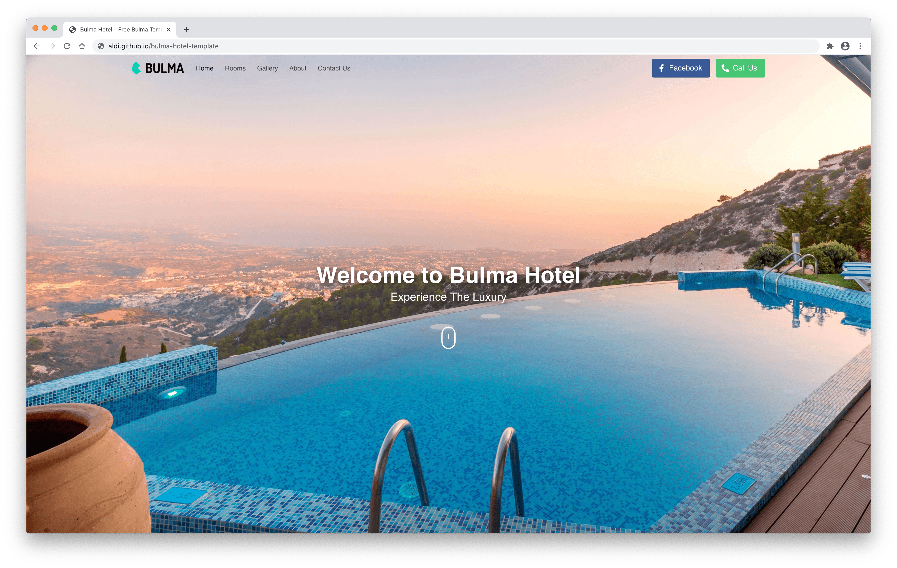

# Guest Sphere — Luxury Hotel & Suites

Welcome to the official website repository for **Guest Sphere**, an upscale boutique hotel and suites offering world-class hospitality, elegant accommodations, and modern amenities for both business executives and leisure travelers.



---

## 🌟 Key Features

- **Responsive Brand Navigation**: Clean header navigation with embedded Guest Sphere branding, quick-contact shortcuts (mobile & desktop), social icons, and an interactive hamburger menu.
- **Hero Showcase**: Full-height hero section with high-resolution imagery, welcoming typography, and an animated smooth-scroll prompt.
- **Room & Suite Catalog**:
  - *Executive Gold Single* (€119 / day)
  - *Executive Gold Double* (€239 / day)
  - *Premier Diamond Single* (€399 / day)
  - *Premier Diamond Double* (€499 / day)
  - Interactive "View Details" modal featuring complete amenity checklists (Wi-Fi, safe, 24/7 check-in, minibar, etc.).
- **Reception & Contact Channels**: Multi-channel contact desk featuring both **Primary** and **Alternative** contact options for seamless guest communication.
- **Hotel Gallery Carousel**: Smooth infinite carousel slider highlighting presidential suites, fine dining, infinity rooftop pool, wellness spa, and executive conference rooms.
- **Inquiry & Contact Desk**:
  - Direct contact quick-cards.
  - Interactive contact form with dedicated **Alternative Contact Detail** field (alternate phone number or backup email).
  - Integrated, high-resolution Google Maps location embed.
- **Newsletter & Social Hub**: Email subscription form with instant feedback and social links.

---

## 📞 Contact Details & Alternative Channels

| Channel | Detail | Type / Notes | Availability |
| :--- | :--- | :--- | :--- |
| **Primary Phone** | `+1 (800) 483-7877` | Toll-Free / Front Desk | 24 Hours / 7 Days |
| **Alternative Phone** | `+1 (555) 876-5432` | 24/7 Reservation Hotline | 24 Hours / 7 Days |
| **Primary Email** | `contact@guestsphere.com` | General Inquiries & Support | Mon–Sun, Fast Response |
| **Alternative Email** | `reservations@guestsphere.com`| Bookings, Events & Banquets | Mon–Sun, Priority Desk |
| **Physical Address** | 742 Grand Horizon Promenade, Suite 500, New York, NY 10001, USA | Central Downtown District | Open Year-Round |

---

## 📁 Project Structure

```plaintext
Guest-Sphere/
├── css/
│   └── styles.css          # Custom styling, animations, reception cards, and layout tweaks
├── js/
│   └── scripts.js          # Carousel initialization, mobile navbar, modal handlers & form feedback
├── media/
│   └── background.jpg      # Hero section background banner image
├── index.html              # Main website landing page for Guest Sphere
├── LICENSE                 # MIT License file
├── README.md               # Project documentation
└── screenshot.png          # Website preview screenshot
```

---

## 🛠️ Built With

- **HTML5 & Semantic Markup**: Structured for SEO and accessibility.
- **CSS3 & Flexbox/Grid**: Clean responsive design with smooth keyframe animations.
- **[Bulma CSS Framework](https://bulma.io/) (v0.9.0)**: Modern, lightweight flexbox-based CSS framework.
- **[Font Awesome 5](https://fontawesome.com/)**: Vector icons for hotel amenities, communication channels, and navigation.
- **[Bulma Carousel](https://github.com/Wikiki/bulma-carousel)**: Interactive touch-friendly image carousel for the gallery.
- **[Bulma Social](https://github.com/aldi/bulma-social)**: Social media button styling.
- **Vanilla JavaScript (ES6)**: Lightweight script handling burger menu toggles, modal dialogs, and carousel binding.

---

## 🚀 Getting Started

### 1. Direct Browser Opening
Simply double-click or open `index.html` in any modern web browser:
```bash
# On Windows (PowerShell):
Start-Process .\index.html
```

### 2. Local Development Server
For optimal loading of external assets and web fonts, run a local development server:

**Using Python:**
```bash
python -m http.server 8000
```
Then visit `http://localhost:8000` in your browser.

**Using Node.js (`npx serve`):**
```bash
npx serve .
```

**Using VS Code Live Server Extension:**
Right-click on `index.html` and select **"Open with Live Server"**.

---

## ⚙️ Customization Guide

### Updating Contact Information
All contact details (phone numbers, alternative hotline, emails, and address) can be adjusted in `index.html`:
- **Navbar / Header**: Lines 33–42 & 79–85.
- **Features Modal**: Lines 210–225.
- **About / Reception Desk**: Lines 260–295.
- **Contact Us Quick Cards & Form**: Lines 430–500.
- **Footer**: Lines 560–585.

### Adjusting Room Pricing & Details
Edit the room cards under `<section class="hero" id="rooms">` in `index.html` to update room names, capacities, descriptions, and daily rates.

### Styling & Theme Colors
Custom styles and brand accents (such as `#03b2e3` cyan, `#344157` navy, and `#d77b5d` coral) are organized in `css/styles.css`.

---

## 🌐 Browser Compatibility

Tested and fully supported on:
- Google Chrome (latest)
- Mozilla Firefox (latest)
- Microsoft Edge (latest)
- Apple Safari (latest)
- Mobile Browsers (iOS Safari, Android Chrome)

---

## 📄 License

This project is licensed under the [MIT License](LICENSE).
